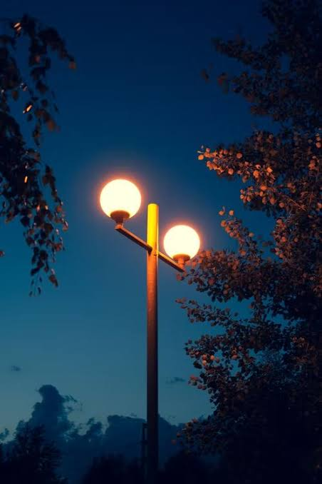
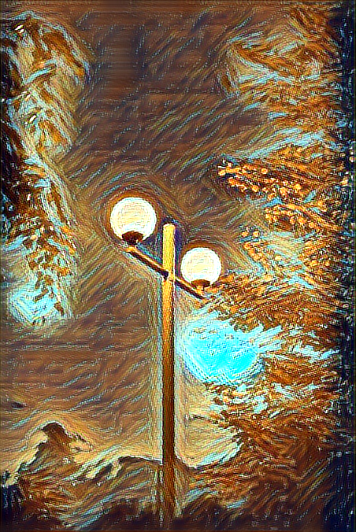

# Kotlin Van Gogh Style Transfer 🌌

Turn ordinary photos, such as cityscapes and street scenes, into paintings in the style of Vincent van Gogh's *The Starry Night*. This is a small, dependency-light Kotlin app that runs a pre-trained **fast neural style transfer** model with **ONNX Runtime**.

   | Before | After |
   |---|---|
   |  |  |


## How it works

Neural style transfer blends the **content** of one image (your photo) with the **style** of another (a painting). The classic method optimizes every output image from scratch, which is slow. This project uses the *fast* approach from [Johnson et al., "Perceptual Losses for Real-Time Style Transfer and Super-Resolution"](https://arxiv.org/abs/1603.08155):

1. A small feed-forward network was trained **once** to paint in one style (a VGG network is used only during that training, as a loss function).
2. At run time, stylizing a photo is a **single forward pass** through that network, so it takes seconds on a CPU.

The Kotlin app does the following:

1. Loads your photo and resizes it (longest side ≤ 768 px, width and height made multiples of 4, which the network requires).
2. Converts the pixels to a `[1, 3, H, W]` float tensor (RGB, values 0–255).
3. Runs the tensor through the ONNX model with ONNX Runtime.
4. Clamps the output to 0–255 and saves it as a PNG.

## Tech stack

- **Kotlin** (JVM) with **Gradle** (Kotlin DSL)
- **[ONNX Runtime](https://onnxruntime.ai/)** for Java, for model inference
- Plain `java.awt` / `javax.imageio` for image handling (no OpenCV needed)

## Requirements

- JDK 17 or newer
- IntelliJ IDEA (Community Edition is fine) or any Gradle-capable setup
- An internet connection for the first Gradle sync (it downloads ONNX Runtime)

## Quick start

1. **Clone the repo**
   ```bash
   git clone https://github.com/<buggedaayush>/<kotlin-van-gogh-style-transfer>.git
   cd <kotlin-van-gogh-style-transfer>
   ```
2. **Open it in IntelliJ IDEA** (*File → Open* → select the project folder) and let Gradle sync.
3. **Put a photo at `images/city.jpg`** (JPG or PNG; or pass your own path, see below).
4. **Run `main`** in `src/main/kotlin/Main.kt` with the green ▶ button.
5. Your result is saved to `output/city_vangogh.png`.

### Use your own photo

Pass the input and output paths as program arguments (*Run → Edit Configurations → Program arguments*):

```
images/my_photo.jpg output/my_photo_vangogh.png
```

### Run from the command line (optional)

Add the `application` plugin to `build.gradle.kts`:

```kotlin
plugins {
    application
}

application {
    mainClass.set("MainKt")
}
```

Then:

```bash
./gradlew run --args="images/city.jpg output/city_vangogh.png"
```

## Project structure

```
.
├── build.gradle.kts
├── src/main/kotlin/Main.kt     # the whole pipeline: load → tensor → model → save
├── models/starry-night.onnx    # pre-trained Starry Night style model
├── images/                     # put your input photos here
├── output/                     # stylized results (git-ignored)
├── tools/fix_old_onnx.py       # script that upgraded the original model (see below)
└── docs/before-after.png       # README image
```

## Configuration

| Setting | Where | Default | Notes |
|---|---|---|---|
| `MAX_SIDE` | top of `Main.kt` | `768` | Longest image side in pixels. Higher means more detail but slower and more memory. |
| Input / output path | program arguments | `images/city.jpg` → `output/city_vangogh.png` | |

## About the model

`models/starry-night.onnx` is a fast-neural-style network trained on *The Starry Night*. The original export is from 2017 and no longer loads in modern ONNX Runtime, so it was upgraded with [`tools/fix_old_onnx.py`](tools/fix_old_onnx.py):

- replaced the removed `ResizeNearest` operator with standard `Resize` (opset 13)
- moved `Pad` settings from attributes to inputs
- reshaped conv biases that relied on legacy broadcasting
- made the input height/width dynamic instead of fixed 540×540

## Limitations

- **One style per model.** This model only paints Starry Night. Another style needs another model.
- **Small, older model.** Results are recognizably Van Gogh-like (swirling strokes, blue/orange palette) but not perfect. Flat areas such as sky can show blotchy artifacts.
- **CPU only** in this starter; speed depends on your machine and `MAX_SIDE`.
- Transparency (alpha) in PNGs is not preserved.

## Ideas / roadmap

- [ ] Batch mode: stylize a whole folder
- [ ] More styles (swap in other fast-neural-style ONNX models)
- [ ] Train a higher-quality Van Gogh model on cityscape images and export it to ONNX
- [ ] Android app version
- [ ] Optional GPU execution provider
- [ ] DJL / KotlinDL variant

## Credits and licenses

- **Method:** Johnson, Alahi, Fei-Fei, [*Perceptual Losses for Real-Time Style Transfer and Super-Resolution*](https://arxiv.org/abs/1603.08155) (2016), with Instance Normalization from Ulyanov et al., [*Instance Normalization: The Missing Ingredient for Fast Stylization*](https://arxiv.org/abs/1607.08022).
- **Model source:** exported ONNX model from [`dzhulgakov/fast-neural-style`](https://github.com/dzhulgakov/fast-neural-style), a fork of [`abhiskk/fast-neural-style`](https://github.com/abhiskk/fast-neural-style) (MIT licensed). Please keep the upstream license notice with the model file.
- **Style:** *The Starry Night* by Vincent van Gogh (public domain).
- **Inspiration:** a Kotlin "Van Gogh-ify" project by Gazi Jarin. <https://www.instagram.com/reel/DeP2tbxBoEe/?vrfl=bmFwZHpqaGsyemJh>
- This project's code: see [LICENSE](LICENSE).
